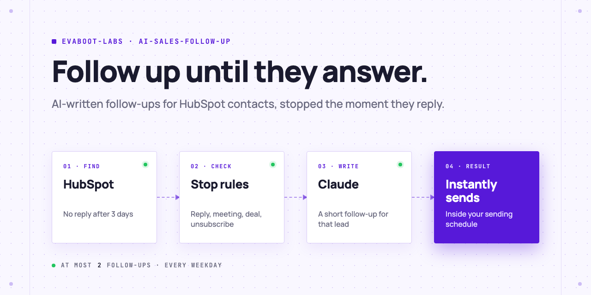
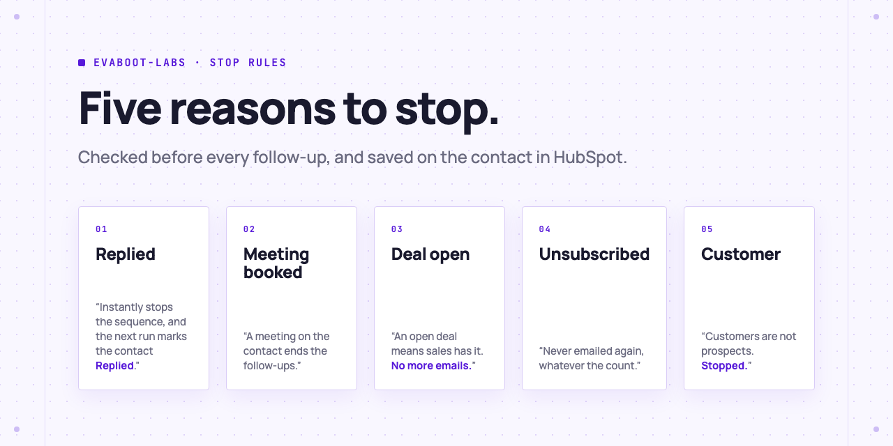

<picture>
  <source media="(prefers-color-scheme: dark)" srcset=".github/assets/banner-dark.png">
  
</picture>

# AI sales follow-up with stop rules

Follow up with every HubSpot contact who did not reply, with a short email Claude writes for that lead, sent through Instantly, and stop once they reply, book a meeting or become a deal.

[](AGENTS.md)
[](LICENSE)

## Set it up in one prompt

Paste this into Claude Code, Codex or Cursor:

```text
Follow up with my HubSpot contacts who did not reply. Clone
https://github.com/evaboot-labs/ai-sales-follow-up, read AGENTS.md and follow the
follow-up skill. Show me a dry run with every draft before you send anything.
```

<details>
<summary>Or install the skill</summary>

Claude Code:

```text
/plugin marketplace add evaboot-labs/ai-sales-follow-up
/plugin install ai-sales-follow-up@evaboot-labs-ai-sales-follow-up
```

Codex, Cursor and other agents:

```bash
npx skills add evaboot-labs/ai-sales-follow-up
```

</details>

## Five reasons to stop

<picture>
  <source media="(prefers-color-scheme: dark)" srcset=".github/assets/stop-rules-dark.png">
  
</picture>

At most 2 follow-ups per contact. Each stop is saved on the contact as `ai_followup_status`, and the writing rules live in [`FOLLOW_UP.md`](FOLLOW_UP.md).

## What you need

- **HubSpot** (the free plan works) with your first emails logged, and a service key: [setup](docs/setup.md).
- **An Anthropic API key** for Claude.
- **Instantly** with a connected mailbox and a one-step campaign.
- **Python 3.11 or later.** No packages to install.
- **Cost:** one Claude call per follow-up, a few cents for a hundred emails.

## Go further

| Page | For |
|---|---|
| [Set up and run](docs/setup.md) | Keys, the Instantly campaign, options and settings |
| [n8n workflow](docs/n8n.md) | The same workflow every weekday in n8n |

---

Agents: start at [AGENTS.md](AGENTS.md) · Built by [Evaboot](https://evaboot.com) · More workflows at [github.com/evaboot-labs](https://github.com/evaboot-labs) · [MIT license](LICENSE)
